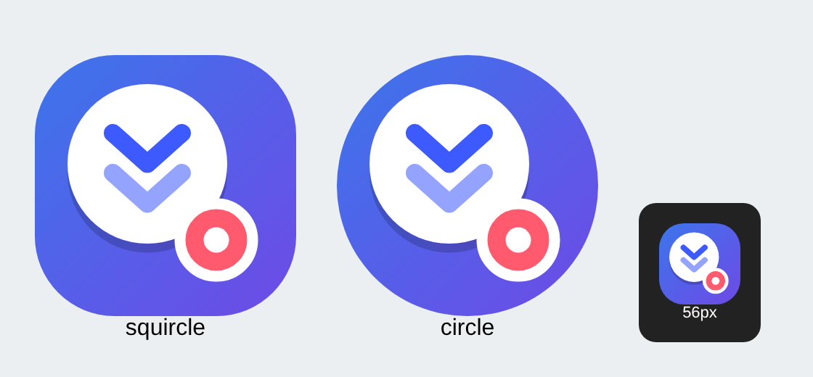

# 플로팅 터치 (Android)



화면 위에 떠 있는 플로팅 버튼 3개를 제공하는 안드로이드 앱입니다.

| 버튼 | 기능 | 조절 범위 |
|---|---|---|
| 파란 버튼 ▼/▲ | 누르면 화면을 한 번 빠르게 스와이프(스크롤) | 스와이프 시간 0.001초 ~ 10초, 스크롤 거리(화면 높이의 5~90%, 0.5% 단위), 끝 멈춤 시간 0~500ms(관성 제거), 방향 위/아래 |
| 빨간 버튼 ▶ / 초록 ■ | 누르면 조준점(⊕) 위치를 반복 터치, 다시 누르면 정지 | 간격 1.0초 ~ 10.0초 (0.1초 단위) |
| 보라 버튼 ↓ / ■ | 누르면 천천히 계속 자동 스크롤, 다시 누르면 정지 | 속도 5~800dp/초 (5 단위), 실행 중 변경 즉시 반영 |

공통: 버튼별 **크기(32~120dp)**, 자동 터치 조준점 크기(16~120dp, 모양만 바뀌고 터치는 항상 중심 한 점)·투명도, **불투명도(20~100%)** 조절, 드래그 이동, **화면 좌우 끝으로 끌어다 놓으면 엣지에 숨김** (숨겨진 버튼을 탭하면 다시 나타남).

## 설치 / 사용
1. `FloatingTouch-debug.apk` 를 폰에 설치 (출처를 알 수 없는 앱 설치 허용 필요)
2. 앱 실행 → **접근성 설정 열기** → 「플로팅 터치 (스크롤/자동 터치)」 켜기
   - Android 13 이상에서 "제한된 설정" 때문에 켜지지 않으면: 앱 정보 → 우측 상단 ⋮ → **제한된 설정 허용** 후 다시 시도
3. 화면에 버튼이 나타나면 사용. 설정값은 앱 화면에서 바꾸면 즉시 반영됩니다.

### 버튼 숨기기/보이기 (서비스를 끌 필요 없음)
접근성 서비스는 한 번만 켜두고, 버튼만 숨기거나 다시 띄웁니다.
- **앱 첫 화면 최상단의 큰 버튼** 1·2·3 ON/OFF, 모두 끄기
- 플로팅 버튼을 **길게 누르기** → 설정 앱 열기
- 상단바 빠른 설정의 **「플로팅 버튼」 타일** → 숨기기/보이기 (처음 한 번 빠른 설정 편집에서 타일 추가)
- 앱 화면의 **「플로팅 버튼 보이기」** 스위치

## 특정 앱에서만 자동으로 켜기 (앱 지정 모드)
설정 화면에서 앱을 고르면, 그 앱이 화면 맨 앞에 올 때 플로팅 버튼이 자동으로 나타나고 다른 앱·홈으로 나가면 사라집니다(실행 중인 자동 터치/스크롤도 정지).
기능을 모두 꺼두면 지정한 앱 안에서는 작은 초록 ☰ 버튼 하나만 보이며, 누르면 설정 앱이 열립니다.
사용 흐름: ☰ 누르기 → 설정에서 기능 켜기 → 웹툰 앱에서 사용 → 기능 버튼 길게 눌러 설정으로 → 모두 끄기 → 다시 ☰ 버튼만 남음.
접근성 이벤트(`TYPE_WINDOW_STATE_CHANGED`) 중 **실제 화면(Activity) 전환**만 앱 전환으로 봅니다. 앱 안에서 뜨는 팝업·광고·패널·토스트, 상태바, 키보드는 무시하고, 다른 앱으로 나간 뒤 0.4초 유예 후 숨깁니다. 설정 화면의 「앱 감지 기록 보기」에서 최근 판정 내역을 확인할 수 있습니다.

## 구현 방식
- `AccessibilityService` 하나로 동작합니다.
  - 플로팅 버튼: `TYPE_ACCESSIBILITY_OVERLAY` 창 (별도 "다른 앱 위에 표시" 권한 불필요)
  - 스크롤/터치: `dispatchGesture()` 로 스와이프·탭 제스처 주입
- 스와이프 경로나 조준점 위에 플로팅 창이 있으면 터치를 가로채므로, 제스처 직전에 해당 창을 잠시 터치 불가로 바꿉니다.
- minSdk 26 (Android 8.0), targetSdk 34

## 빌드
```
./gradlew assembleDebug   # local.properties 에 sdk.dir 지정 필요
```

## 관성(미끄러짐) 제거 원리
스와이프 끝 지점에서 손가락을 떼지 않고 설정 시간만큼 멈춰 있다가 뗍니다(`continueStroke`). 안드로이드 VelocityTracker는 마지막 움직임 뒤 일정 시간 멈추면 속도를 0으로 판단하므로 플링이 발생하지 않습니다.

## 자동 스크롤 원리
200ms 길이의 드래그 조각을 `continueStroke`로 계속 이어 붙여, 손가락을 대고 일정 속도로 끌어올리는 동작을 흉내 냅니다. 화면 80%→20% 지점까지 오면 멈췄다 떼고(관성 없음) 다시 아래에서 시작합니다. 사용자가 화면을 만지거나 다른 기능이 제스처를 보내면 진행 중 제스처가 취소되며, 1초 뒤 자동으로 재개합니다.

## 한계
- 0.001초처럼 극단적으로 짧은 스와이프는 앱마다 해석이 다릅니다(아주 빠른 플링 / 무시 / 탭으로 처리 등). 실제 기기에서 원하는 대로 안 되면 시간을 늘려보세요.
- 시스템 보안 화면(잠금화면, 일부 결제 화면 등)이나 접근성 제스처를 차단하는 앱에서는 동작하지 않을 수 있습니다.
- 자동 터치는 게임/서비스 이용약관에 위반될 수 있습니다.
